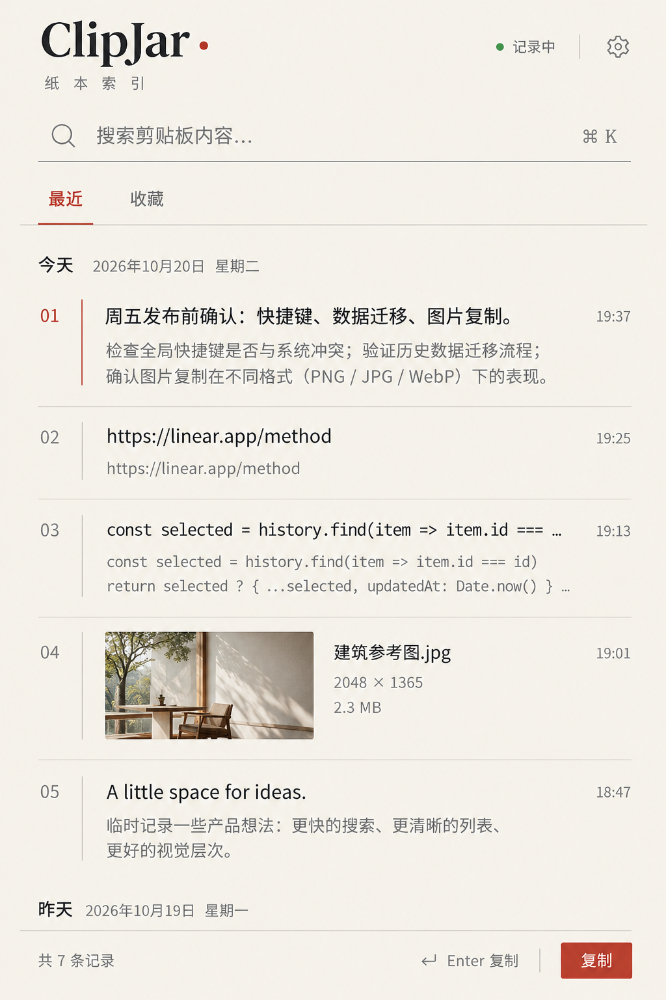
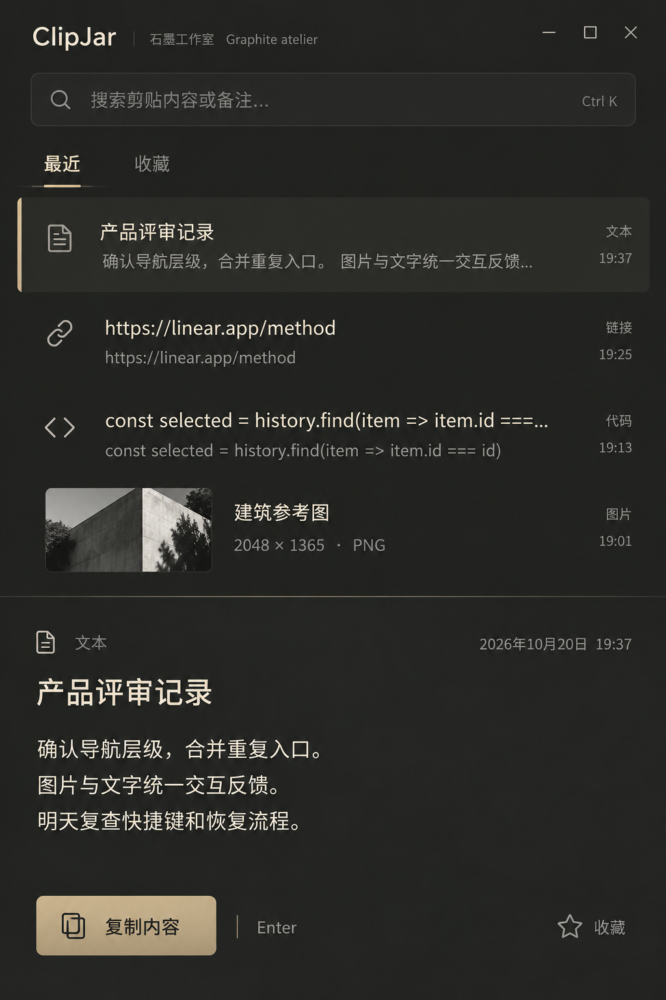

# ClipJar 设计概念稿

以下是 2026 年 10 月 20 日本轮出图模型生成的三张独立概念稿，尚未实现到应用中。编号按照本轮生成结果在对话中的显示顺序。

推荐从第 1 张继续细化：米白与朱红的书刊式排版形成较完整的视觉性格，适合以文字检索、阅读和复制为主的剪贴板工具。细化时仍需核对真实窗口内的信息密度、对比度和可操作性。

## 1 · 纸本索引（推荐）

米白、朱红、衬线品牌字与编号索引。

[打开完整图片](design/concepts/01-editorial.png)

## 2 · 钴蓝构成

钴蓝顶部、明确信息分区，以选中图片的查看与复制为主。

[打开完整图片](design/concepts/02-cobalt.png)

## 3 · 石墨工作室

深石墨、暖白文字与少量黄铜色，下方展开选中内容。

[打开完整图片](design/concepts/03-graphite.png)

