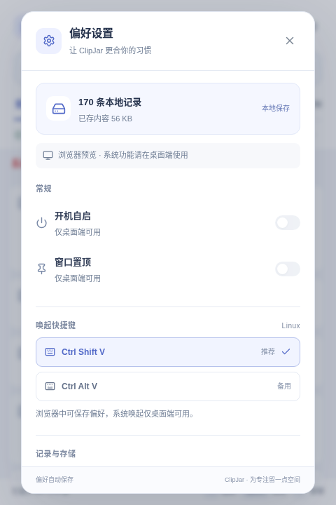

# ClipJar 界面优化记录

本次检查覆盖主界面的查找与收藏、内容预览、偏好设置。截图均来自本轮运行的浏览器开发模式，使用独立示例数据；带“记录中”的截图使用原生命令和事件模拟，不代表已在 Windows/macOS 原生窗口中完成视觉验收。

## 检查步骤与结果

| 步骤 | 页面与操作 | 原界面观察 | 优化后状态 |
| --- | --- | --- | --- |
| 1 | 浏览记录、搜索和收藏 | 顶部约 214 px，按钮与正文争夺行宽；同类浅蓝边框使主次不清 | 顶部约 184 px；状态收进右上角；正文独占行宽，按内容类型区分图标；正文从 13 px 调至 14 px |
| 2 | 文本与图片预览 | 能展示全文，但按钮、背景和主界面之间缺少统一的重点色 | 使用同一套暖白、墨绿与灰绿色；复制按钮突出，文本保留换行和选择能力，图片支持缩放 |
| 3 | 打开设置、缩小窗口、键盘导航 | 次级说明偏淡，设置分组仅靠分隔线，较长页面不容易扫读 | 分组采用标题与独立设置行，危险操作使用低饱和暖色；420 × 600 下弹窗保持在窗口内并能滚动，键盘焦点保持在弹窗中 |

## 证据

优化前主界面与设置：

优化后的完整截图见[界面预览](ui-preview.md)。原界面与新版截图使用不同示例内容，用于说明布局与视觉层级；不用于比较存储条数或性能。

## 可访问性与验证范围

- 保留按钮名称、收藏状态、焦点提示、弹窗焦点约束和键盘快捷操作。悬停隐藏的次要操作在键盘聚焦和触摸环境下仍可见。
- 常用辅助文字统一为 `#687262`，在白色背景上约 5.03:1，在设置页背景上约 4.85:1。彩色图标有相邻文字说明。上述数值仅覆盖这些颜色组合，不能代表整套界面符合所有可访问性要求。
- 复查 480 × 720 常用窗口、420 × 600 定时暂停和设置、960 × 720 横向布局、无搜索结果、全文与图片预览；未发现横向溢出或截断的控制区。
- 前端构建、33 项单测和浏览器回归通过。浏览器回归覆盖分页、全文预览、系统设置失败与重试、暂停、撤销、迁移、焦点和小窗口边界。
- 本轮未复测真实系统剪贴板和原生窗口渲染，操作系统缩放与屏幕阅读器读序仍需在目标桌面上验证。
