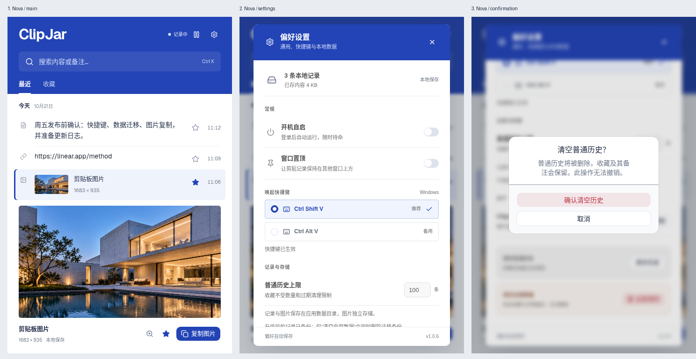

# ClipJar Nova 组件迁移

保留选中的钴蓝与白色构成，将当前基础控件统一为 **shadcn/ui Nova（Radix）**。图标使用 Lucide，交互动效使用 Motion，状态继续使用 Zustand。默认 Nova 的 Geist 字体在应用内自托管，中文按系统字体回退。

本次替换按钮、输入框、备注框、开关、单选筛选、快捷键选择、弹窗、暂停菜单和工具提示。清空数据使用明确的确认弹窗；保留剪贴板复制、收藏、备注、迁移、隐私暂停与图片工作区。

上图为本轮实际浏览器运行：主界面、设置和清空确认。使用隔离示例数据与原生命令模拟。另有 Linux Tauri 原生窗口截图，详见[界面预览](ui-preview.md)。

[组件来源与选型](component-system.md) · [视觉 QA](../design-qa.md) · [验证记录](freeze-report.md)
