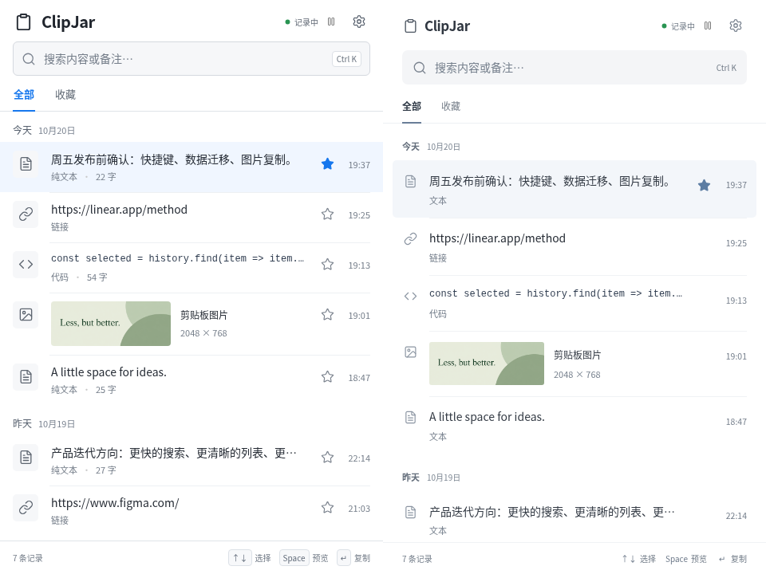

# ClipJar 样式细化

继续保留用户选定的原生列表方向。本轮目标是提高日常阅读与操作时的协调感，保持功能和信息结构稳定。

1. 去除图标底块、重复空心星标和列表字数，减少视觉噪声。
2. 收细品牌标题，统一横向边距、行距和说明文字；底部快捷键取消键帽边框。
3. 使用克制的灰蓝色与轻量选中态，让正文成为主要视觉内容。
4. 设置、预览同步调整间距和文字说明。

完整验证见[视觉 QA](../design-qa.md)，当前截图见[界面预览](ui-preview.md)。对照图左为改前，右为改后，均为本轮实际浏览器运行截图与同一组示例内容。

截图使用独立示例数据与原生命令/事件模拟，不代表已完成目标操作系统的原生窗口验收。
