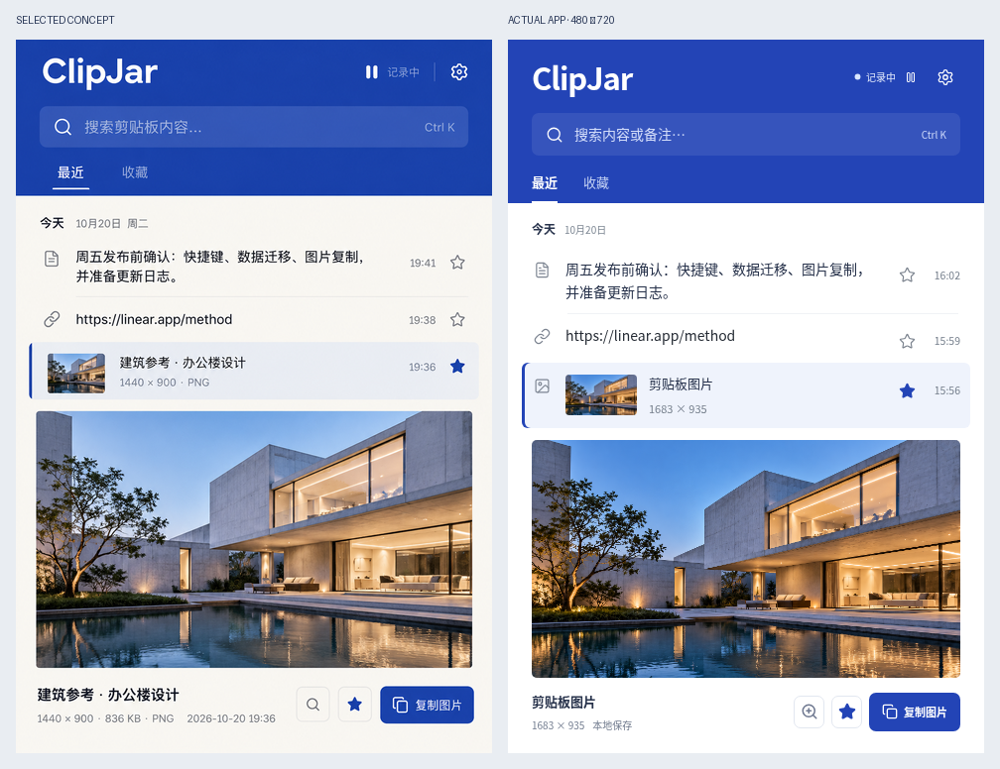

# ClipJar 钴蓝与白色

按用户选中的[钴蓝构成稿](design/concepts/02-cobalt.png)完成。大面积钴蓝顶栏搭配纯白主体，保留连续列表；颜色集中在品牌、导航、选中标记和主要动作。

图片记录增加内联工作区：选择后直接看大图、收藏或复制，需要时再进入完整预览。尺寸来自原始记录，没有备注时使用“剪贴板图片”。示例建筑照片只用于截图和测试，不随生产应用加载。

设置、预览与小窗口同步调整。详细检查见[视觉验收](../design-qa.md)，测试和构建结果见[封板记录](freeze-report.md)。

左侧为选中的概念稿，右侧为实际浏览器运行截图。纯白主体是按用户最新要求作出的调整；图片内容为生成的独立示例素材。
