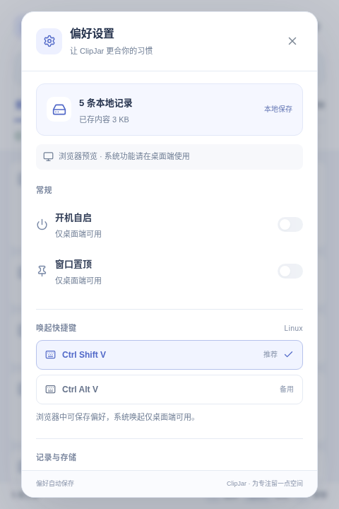
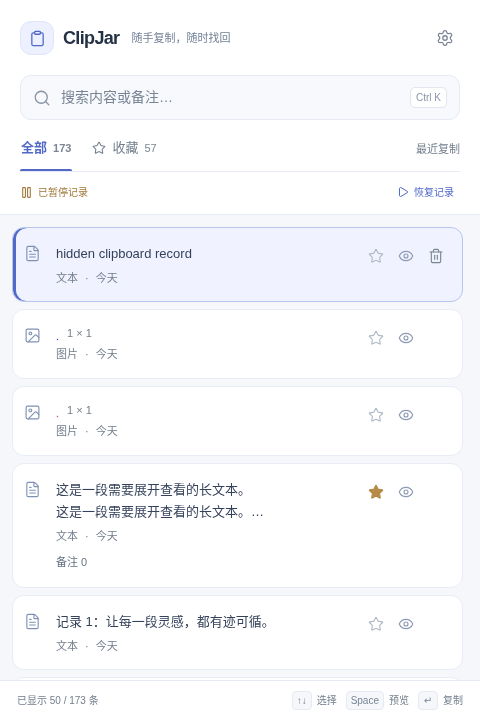
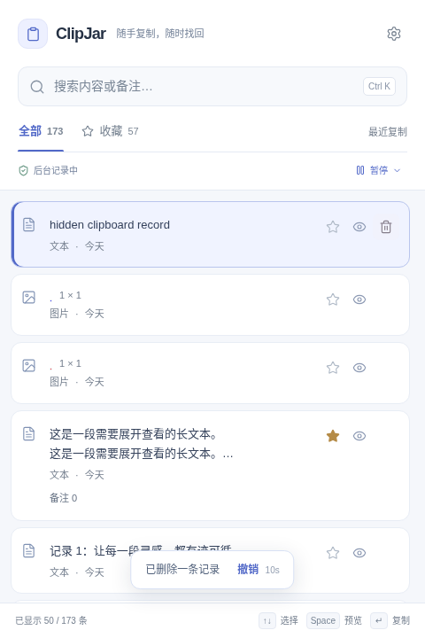

# ClipJar 界面预览

以下截图来自实际运行的浏览器开发模式，窗口为 480 × 720，使用独立示例数据。系统剪贴板、开机自启、窗口置顶和托盘行为需在 Windows/macOS 桌面端验证。

## 主界面

历史按批次加载，搜索覆盖全部保留记录。点击记录复制，点击眼睛图标或按空格预览。

## 全文预览

保留完整文本与换行，支持选择内容。Enter 复制，Esc 关闭；图片预览支持适应窗口和实际大小切换。

## 偏好设置

浏览器中明确显示系统功能不可用；桌面端提供读取、失败、超时和重试状态，快捷键按平台推荐。

## 隐私暂停与删除撤销

以下两张使用浏览器中的原生命令/事件模拟与独立测试数据，展示暂停和撤销状态；不代表 Windows/macOS 原生运行截图。

