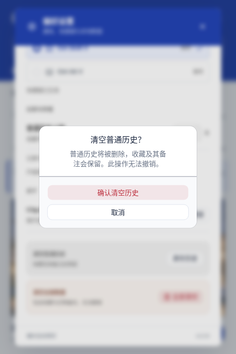

# ClipJar · Nova 组件版

**shadcn/ui Nova + Lucide + Motion + Zustand**，保留钴蓝与白色主题。这里展示的是已经实现并运行的界面。

## 组件概览

左为主界面，中间为设置，右为清空确认。基础组件统一使用 Nova；分栏与拖拽尚无功能需求，未引入对应库。

## 主界面

文本点击复制；图片点击展开工作区。Enter 复制，Space 打开完整预览。收藏、备注、搜索和隐私暂停保持可用。

## 设置与清空确认

开关保留真实桌面状态与失败重试。清空操作使用确认弹窗，默认焦点在取消；清空普通历史会保留收藏和备注。

## 暂停、预览与撤销

## 420 × 600 小窗口

## Linux 原生运行

下面直接捕获 Linux/Xvfb 中 Tauri 二进制的窗口客户区，使用隔离 SQLite 示例数据与真实本地图片。

其余截图来自本轮实际 React 页面与隔离原生命令模拟，不标作 Windows/macOS 原生截图。

[组件体系与官方来源](component-system.md) · [设计稿对照](screenshots/cobalt-comparison.png) · [测试结果](freeze-report.md)
