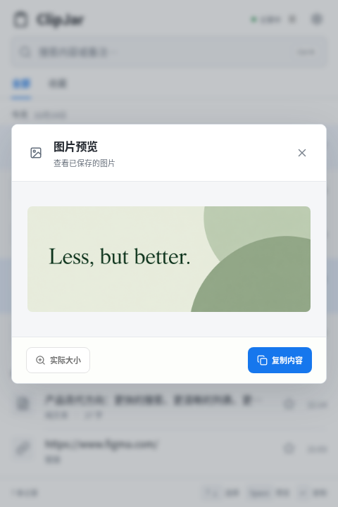

# ClipJar 界面预览

新版采用原生列表方向：白底、系统字体、细线分隔，蓝色表示选中与活动状态。以下均为实际运行的浏览器截图，使用独立示例数据。带“记录中”的页面使用原生命令与事件模拟，系统剪贴板与原生窗口效果仍需在桌面端确认。

## 主界面

按今天、昨天与日期分组。收藏与时间对齐在右侧；悬停或键盘聚焦记录时，可以预览、删除或编辑收藏备注。

## 内容预览

完整文本保留换行并支持选择；图片支持适应窗口与实际大小。复制使用统一的主按钮。

## 偏好设置

常规、快捷键、数据设置采用统一分组，自动保存。普通历史和全部数据清空分别确认。

## 暂停与撤销

采集状态收进右上角。暂停可选 15 分钟、1 小时或手动恢复；删除后提供 10 秒撤销。

## 小窗口

420 × 600 窗口下仍可操作暂停、搜索与设置，列表和设置内容可滚动。

详细检查过程与验证范围见[界面优化记录](design-review.md)。
