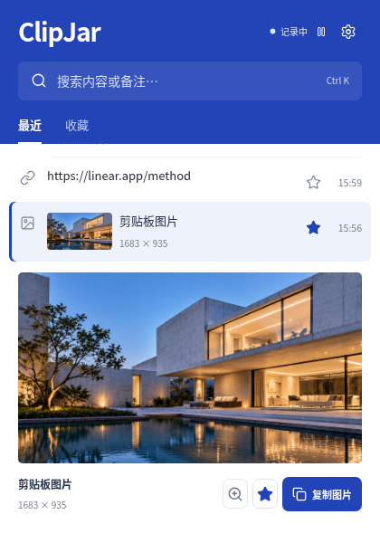
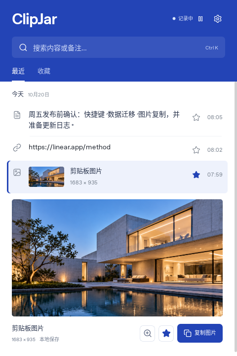

# ClipJar 钴蓝与白色界面

按用户选中的钴蓝构成方案落地：钴蓝顶栏、纯白主体、连续列表和图片工作区。下面都是实际运行截图，使用隔离示例数据与原生命令模拟。

## 主界面与图片工作区

文本点击复制；图片点击展开大图，支持放大、收藏和复制。键盘 Enter 复制，Space 打开完整预览。

## 偏好设置

## 完整内容预览

## 暂停与撤销

## 小窗口

420 × 600 下主体可滚动，复制、收藏、搜索、设置和暂停仍可操作。

[设计稿与运行效果对照](screenshots/cobalt-comparison.png) · [视觉验收](../design-qa.md) · [封板记录](freeze-report.md)

## Linux 原生运行

下图直接捕获 Tauri 二进制的窗口客户区，运行于 Linux/Xvfb，使用隔离的 SQLite 示例数据。图片通过本地 asset 协议加载；实际点击“复制图片”成功，后端使用次数由 0 增至 1。此云桌面使用 UTC，所以上图与此图的示例时间不同。

前面的图片展示浏览器界面，不代表 Windows/macOS 原生窗口的像素效果。各平台原生测试结果单独记录在封板报告中。
